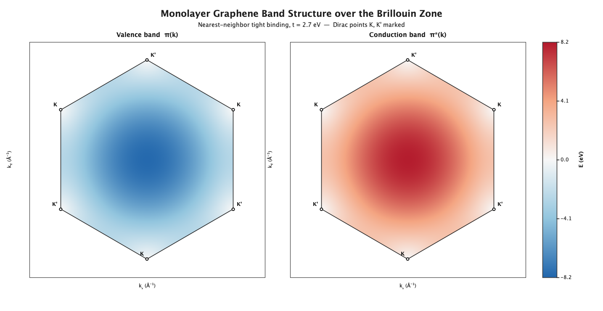
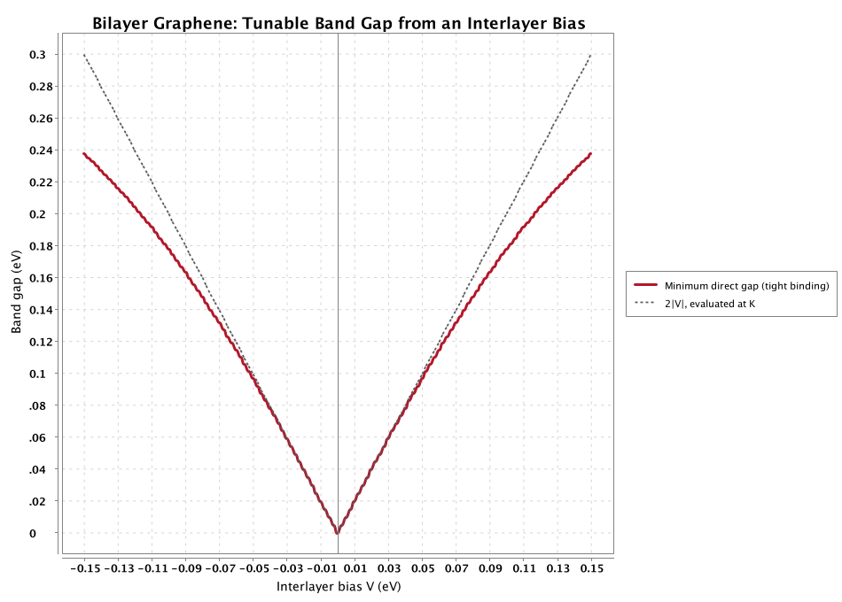
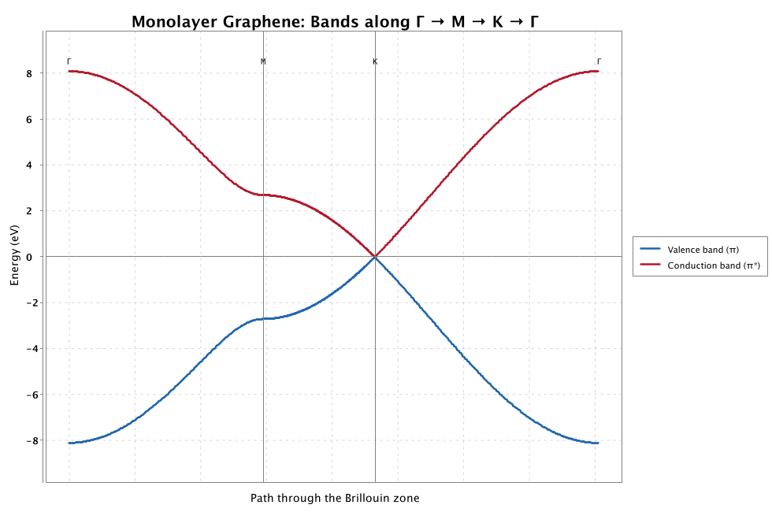
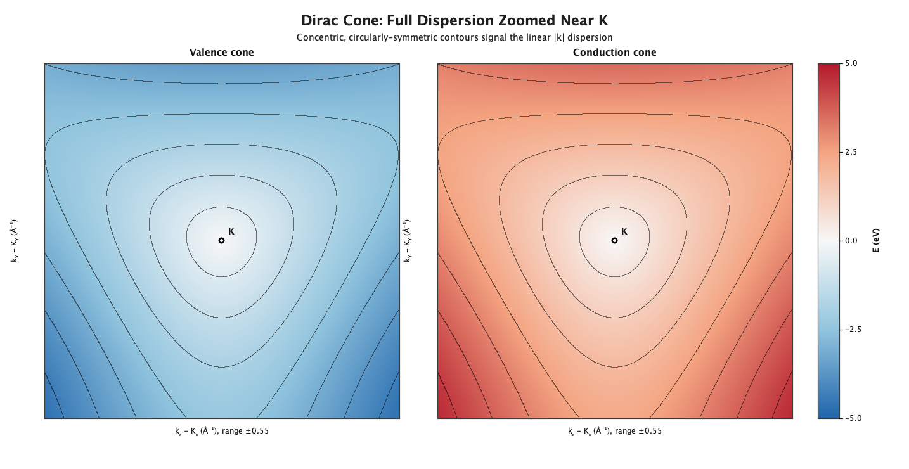
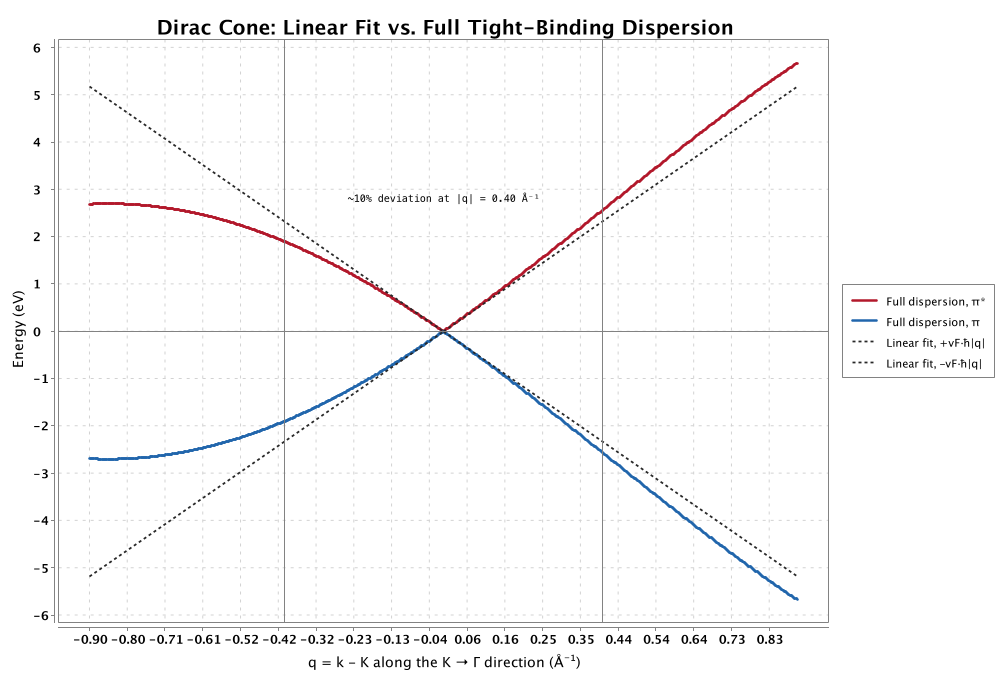
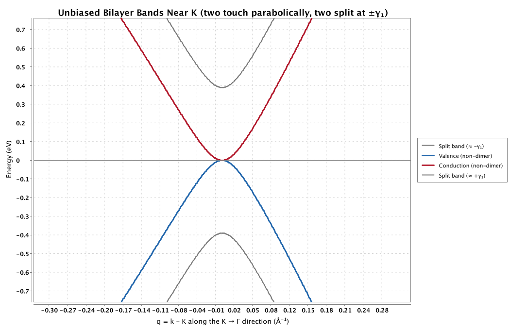
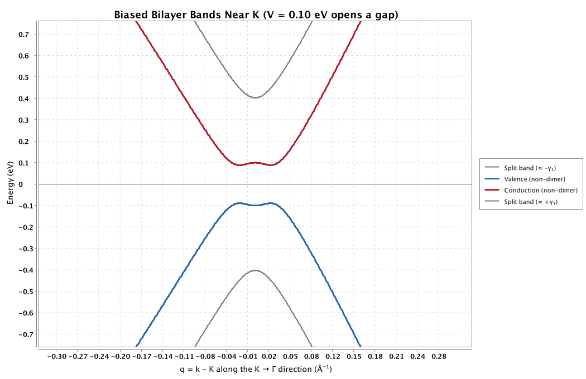

# Graphene Tight-Binding Simulations

A from-scratch Java implementation of tight-binding electronic structure
calculations for graphene: the honeycomb lattice, the monolayer band
structure and its Dirac cones, and the tunable band gap of Bernal-stacked
bilayer graphene.

The project is intentionally narrow in scope. It covers exactly three
pieces of physics — nearest-neighbor tight binding on a honeycomb lattice,
the linear (Dirac) approximation near the band-touching points, and the
minimal two-parameter Bernal bilayer Hamiltonian — each implemented and
documented well enough to be defended line by line. It does not attempt
transport/scattering calculations, nanoribbons, disorder, or magnetic-field
physics.

## Featured figures

**Monolayer band structure over the full Brillouin zone**, with the K and K'
Dirac points marked:



**Tunable band gap of bilayer graphene.** Unlike a single graphene layer,
which never has a gap, Bernal-stacked bilayer graphene opens a gap that
grows with an applied interlayer electric field:



## Physics background

### The honeycomb lattice

Graphene is a single layer of carbon atoms arranged in a honeycomb pattern.
A honeycomb is *not* a Bravais lattice — no single set of translations
reaches every atom from one starting atom — so it is described as two
interpenetrating triangular sublattices, A and B, with one atom of each per
unit cell. The lattice vectors are

$$\mathbf{a}_1 = \frac{a}{2}\left(3,\ \sqrt{3}\right), \qquad
\mathbf{a}_2 = \frac{a}{2}\left(3,\ -\sqrt{3}\right), \qquad
a = 1.42\ \text{Å (the carbon-carbon bond length)}$$

with reciprocal lattice vectors

$$\mathbf{b}_1 = \frac{2\pi}{3a}\left(1,\ \sqrt{3}\right), \qquad
\mathbf{b}_2 = \frac{2\pi}{3a}\left(1,\ -\sqrt{3}\right).$$

The hexagonal Brillouin zone this generates has two physically distinct
corners, the **K** and **K'** points,

$$\mathbf{K} = \left(\frac{2\pi}{3a},\ \frac{2\pi}{3\sqrt{3}\,a}\right), \qquad
\mathbf{K}' = \left(\frac{2\pi}{3a},\ -\frac{2\pi}{3\sqrt{3}\,a}\right),$$

which turn out to be exactly where the interesting physics below happens.

### Monolayer tight binding and the Dirac cones

Each carbon atom contributes one loosely bound $p_z$ electron to a
delocalized "$\pi$ band." In the tight-binding approximation, an electron is
allowed to hop between nearest-neighbor A and B sites with amplitude $t
\approx 2.7\text{-}2.8\ \text{eV}$. Fourier transforming this hopping problem
gives a $2\times2$ Bloch Hamiltonian per unit cell,

$$H(\mathbf{k}) = \begin{pmatrix} \varepsilon_0(\mathbf{k}) & -t\,f(\mathbf{k}) \\
-t\,f(\mathbf{k})^{*} & \varepsilon_0(\mathbf{k}) \end{pmatrix}, \qquad
f(\mathbf{k}) = \sum_{i=1}^{3} e^{\,i\,\mathbf{k}\cdot\boldsymbol{\delta}_i},$$

where $\boldsymbol{\delta}_i$ are the three nearest-neighbor vectors and
$\varepsilon_0(\mathbf{k})$ is an optional next-nearest-neighbor correction
(zero unless stated otherwise). Diagonalizing $H(\mathbf{k})$ gives the two
$\pi$ bands,

$$E_{\pm}(\mathbf{k}) = \varepsilon_0(\mathbf{k}) \pm t\,\lvert f(\mathbf{k}) \rvert,$$

which touch with zero gap exactly where $f(\mathbf{k}) = 0$ — which happens
only at $\mathbf{K}$ and $\mathbf{K}'$. Expanding $f(\mathbf{K}+\mathbf{q})$
to first order in $\mathbf{q}$ shows that near a Dirac point, the dispersion
becomes **linear** rather than the usual parabolic $\hbar^2 k^2/2m$:

$$E(\mathbf{q}) \approx \pm\, \hbar v_F \lvert \mathbf{q} \rvert, \qquad
v_F = \frac{3ta}{2\hbar} \approx 1\times10^{6}\ \text{m/s}.$$

This is the origin of graphene's celebrated "massless Dirac fermion"
low-energy electrons: not literally relativistic, but obeying the same
linear, direction-independent dispersion relation as massless relativistic
particles, purely as a consequence of the honeycomb lattice's geometry.

### Bilayer graphene and its tunable gap

Stack a second graphene layer on top of the first in the natural ("Bernal"
or "AB") registry, so that one sublattice of the top layer sits directly
above one sublattice of the bottom layer. Those vertically-aligned "dimer"
sites (A1, A2) acquire a strong direct interlayer hopping $\gamma_1 \approx
0.39\ \text{eV}$, while the other two ("non-dimer") sites, B1 and B2, do
not. Keeping only this minimal two-parameter model ($\gamma_0 = t$ for
intralayer hopping, $\gamma_1$ for the dimer coupling) and an interlayer
bias $V$ (half the on-site energy difference an applied field induces
between the two layers), the $4\times4$ Hamiltonian in the basis
(A1, B1, A2, B2) is

$$H(\mathbf{k}) = \begin{pmatrix}
-V & -\gamma_0 f(\mathbf{k}) & \gamma_1 & 0 \\
-\gamma_0 f(\mathbf{k})^{*} & -V & 0 & 0 \\
\gamma_1 & 0 & V & -\gamma_0 f(\mathbf{k}) \\
0 & 0 & -\gamma_0 f(\mathbf{k})^{*} & V
\end{pmatrix}.$$

At $V=0$, diagonalizing this at $\mathbf{k}=\mathbf{K}$ gives two bands that
touch exactly at zero energy (from the B1/B2 subspace) and two bands split
off by $\pm\gamma_1$ (from the A1/A2 dimer subspace). Away from $\mathbf K$,
virtual hopping through the gapped dimer states gives the touching bands a
small **quadratic** dispersion, unlike monolayer graphene's linear cone —
bilayer low-energy carriers behave as massive, rather than massless, Dirac
fermions. Turning on $V$ splits the touching bands directly at $\mathbf K$
by $2V$, and — as the biased-bands figure below makes visible — the true
minimum gap actually occurs at a small but nonzero $\lvert\mathbf{k}-\mathbf
K\rvert$, not exactly at $\mathbf K$, a subtlety sometimes called the
"Mexican-hat" band structure. Because this gap is set by an *external* field
rather than by the fixed lattice geometry, it can be tuned continuously from
zero — something monolayer graphene's Dirac cone can never do.

## Figure gallery

| | |
|---|---|
|  |  |
| (a) Full band structure over the Brillouin zone | (b) Bands along Γ → M → K → Γ |
|  |  |
| (c) Zoomed dispersion near K | Linear Dirac-cone fit vs. full dispersion |
|  |  |
| (a) Unbiased bilayer bands | (b) Biased bilayer bands (gap at K) |
|  | |
| (c) Bilayer gap vs. interlayer bias (centerpiece) | |

## Project layout

```
src/main/java/graphene/
  lattice/     Honeycomb lattice geometry, reciprocal space, Dirac points,
               and the shared EJML-based complex Hermitian eigensolver.
  monolayer/   2x2 Bloch Hamiltonian, diagonalized over the Brillouin zone,
               and the three monolayer figures (heatmap, high-symmetry
               path, and a zoomed cone with iso-energy contours).
  dirac/       The linear Dirac-cone approximation: analytic vs. numerically
               fitted Fermi velocity, and the overlay figure showing where
               the approximation holds and where it breaks down.
  bilayer/     4x4 Bernal bilayer Hamiltonian (gamma0, gamma1, interlayer
               bias V) and its three figures, including the gap-vs-bias
               centerpiece.
```

Each class's Javadoc explains *why* each term appears in its Hamiltonian,
not just what the code computes.

## Building and running

Requires Java 17+ and Maven.

```sh
mvn compile

# Regenerate each group of figures (written to ./figures):
mvn exec:java -Dexec.mainClass=graphene.monolayer.MonolayerBandStructure
mvn exec:java -Dexec.mainClass=graphene.dirac.DiracConeAnalysis
mvn exec:java -Dexec.mainClass=graphene.bilayer.BilayerBandStructure
```

The `DiracConeAnalysis` run also prints the analytic and numerically fitted
Fermi velocities to stdout, so the tight-binding diagonalization can be
checked against the closed-form $v_F = 3ta/(2\hbar)$ directly.

## Numerics

- **Diagonalization**: [EJML](http://ejml.org/) (`org.ejml`) doesn't ship a
  native complex-matrix eigensolver, so each complex Hermitian Bloch
  Hamiltonian is diagonalized by embedding it as a real symmetric matrix
  twice its size (a standard trick — see the Javadoc on
  `graphene.lattice.HermitianEigenSolver`) and diagonalizing that instead.
- **Plotting**: 2D line/band plots use [XChart](https://knowm.org/open-source/xchart/).
  The centerpiece Brillouin-zone and Dirac-cone heatmaps are rendered
  directly with Java2D, since a clean, labeled, presentation-quality 2D
  heatmap with overlaid Brillouin-zone geometry needed more control than a
  charting library's heatmap component offered.

## References

- P. R. Wallace, "The Band Theory of Graphite," *Phys. Rev.* **71**, 622 (1947).
- A. H. Castro Neto, F. Guinea, N. M. R. Peres, K. S. Novoselov, and A. K.
  Geim, "The electronic properties of graphene," *Rev. Mod. Phys.* **81**,
  109 (2009).
